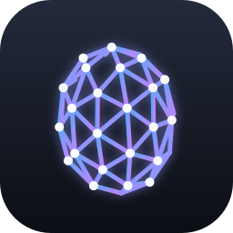
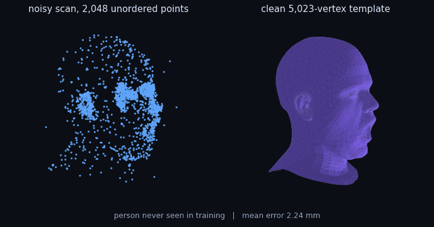
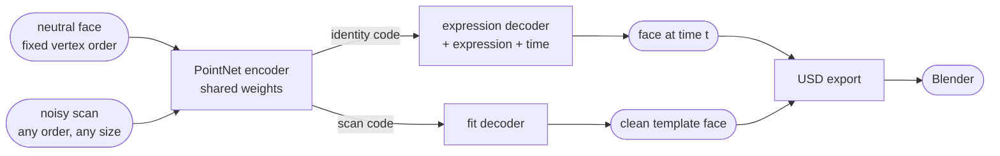
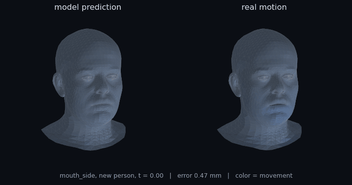

<div align="center">



# FaceMesh

**One PyTorch network that animates 3D faces and turns messy face scans into clean, animation-ready meshes.**

[](requirements.txt)
[](facemesh/model.py)
[](facemesh/export_usd.py)
[](Dockerfile)
[](LICENSE)

<a href="#quick-start">⚡️ Quick start</a> • <a href="#how-it-works">🔬 How it works</a> • <a href="#results">📊 Results</a> • <a href="#blender">🎬 Blender</a> • <a href="#gpu-training">☁️ GPU training</a> • <a href="#faq">❓ FAQ</a>

<br>



</div>

## ✨ What it does

- **Animates a face.** Give it a person's neutral face, an expression and a time from 0 to 1, and it predicts every vertex of the face at that moment. Sixty time steps make an animation.
- **Cleans up scans.** Give it a raw point cloud of a face, in any order, with noise, a hole and stray points, and it returns a clean face on the standard template: fixed vertex count, fixed vertex order, ready to rig and animate.
- Does both with one shared PointNet encoder and two small decoders.
- Exports animated USD files that open in Blender.
- Always reports against a simple baseline, on people it has never seen and on frames it has never seen.
- Trains on an Apple Silicon GPU, an NVIDIA GPU or a CPU, with a Docker image and an AWS script for cloud GPUs.

<a name="quick-start"></a>
## ⚡️ Quick start

```bash
git clone https://github.com/simar-s2/facemesh && cd facemesh
python3 -m venv .venv
.venv/bin/pip install torch -r requirements.txt
```

**1. Get the data.** Request access to [CoMA](https://coma.is.tue.mpg.de), unzip it so you have `COMA_data/<person>/<expression>/*.ply`, and turn it into one file:

```bash
.venv/bin/python scripts/preprocess_coma.py --coma_root path/to/COMA_data --out data/coma.npz
```

It checks that every mesh shares one template (5,023 vertices for FLAME) and stops with the file name if one doesn't. Add `--frame_step 3` to keep every third frame: neighbouring frames are nearly identical, so training gets about 3x faster for little loss.

**2. Train.**

```bash
.venv/bin/python -m facemesh.train --data data/coma.npz --out_dir runs/coma_subject --epochs 30
```

Training prints the baseline first (the number to beat), then the untrained model as epoch 0, then both jobs' error in millimeters every epoch. The best checkpoint goes to `best.pt` and the full history to `metrics.json`. Add `--split interpolation` to hold out frames instead of people.

**3. Run it.** Animate a person, one `.usda` per expression:

```bash
.venv/bin/python -m facemesh.export_usd expressions --checkpoint runs/coma_subject/best.pt \
    --data data/coma.npz --subject FaceTalk_170915_00223_TA --out_dir exports/new_person
```

Clean up a scan (any `.ply` or `.obj`, in meters, facing the same way as the template):

```bash
.venv/bin/python -m facemesh.export_usd fit --checkpoint runs/coma_subject/best.pt \
    --scan my_scan.ply --out_dir exports/my_scan
```

<a name="how-it-works"></a>
## 🔬 How it works



- **PointNet encoder.** The same small network runs on every point, then a max over all points keeps the strongest response per feature. Max ignores order, so a shuffled scan gives exactly the same result. A test checks this.
- **Two decoders.** Both predict *offsets*: how far each vertex moves from the neutral face (animation) or from the average face (scan cleanup). Their last layer starts at zero, so an untrained model returns "no change", and training starts from a sensible answer.
- **Time features.** Time goes in as `[t, sin(πt), cos(πt), sin(2πt), cos(2πt)]`, because expressions rise and fall over a clip.
- **Loss.** L1 per vertex, plus an edge-length term that keeps the surface smooth instead of crumpled.
- **Baseline.** For each expression and tenth of the clip, the average motion over training people. The model has to beat it to be worth anything.
- **Simulated scans.** Every training sample gets a freshly simulated scan of its clean mesh: a hole, 1.5 mm jitter, 2% stray points, shuffled. The clean mesh is the answer key, so scan pairs are free and unlimited.

<a name="results"></a>
## 📊 Results

Mean vertex error in millimeters, lower is better. **New people:** the last 2 people are held out of training. **Seen people:** every 10th frame is held out, everyone is in training. For scan cleanup, the reference is "output the average face".

**CoMA** (20,465 real face meshes, 12 people, 12 expressions, 5,023-vertex FLAME template, 30 epochs):

| | expression: baseline | expression: model | scan cleanup: average face | scan cleanup: model |
|---|---|---|---|---|
| New people | **1.58** | COMA_NEW_EXPRESSION | 5.28 | **2.67** |
| Seen people | 1.41 | **0.45** | 4.32 | **0.83** |

On people it has trained on, the model is about 3x better than the baseline at expressions and 5x better than the average face at scan cleanup. On new people it still cleans scans 2x better than the average face. COMA_NEW_PEOPLE_SENTENCE

<p align="center">
  
</p>

<a name="blender"></a>
## 🎬 Open it in Blender

File → Import → Universal Scene Description, pick an expression `.usda`, then press play. Each file is one mesh, Y-up, in meters, at 30 fps, with one time sample per frame (60 frames).

<a name="gpu-training"></a>
## ☁️ GPU training

**On a Mac.** Training uses the Apple GPU automatically. At CoMA size, an epoch takes about 70 s on an M1 Pro, so both splits take a little over an hour:

```bash
caffeinate -i .venv/bin/python -m facemesh.train --data data/coma.npz --out_dir runs/coma_new_people --epochs 30 --num_workers 3
caffeinate -i .venv/bin/python -m facemesh.train --data data/coma.npz --out_dir runs/coma_seen_people --epochs 30 --num_workers 3 --split interpolation
```

`caffeinate -i` keeps the Mac awake. The results above were trained this way.

**On AWS.** The Docker image (`pytorch/pytorch:2.5.1-cuda12.4-cudnn9-runtime`) and `scripts/train_on_aws.sh` train both splits on one GPU machine:

1. Upload the data: `aws s3 cp data/coma.npz s3://YOUR_BUCKET/data/coma.npz`
2. Launch a **g5.xlarge** (one NVIDIA A10G) with the **Deep Learning Base OSS Nvidia Driver GPU AMI (Ubuntu)**, 100 GB of disk, and an IAM role that can read and write the bucket.
3. SSH in, then:
   ```bash
   git clone https://github.com/simar-s2/facemesh && cd facemesh
   BUCKET=YOUR_BUCKET ./scripts/train_on_aws.sh
   ```
   It builds the image, trains both splits with bfloat16 mixed precision, and syncs `runs/` back to S3.
4. **Terminate the instance when it finishes.** It costs about $1 an hour while it runs.

<a name="faq"></a>
## ❓ FAQ

COMA_FAQ_NEW_PEOPLE

**Why no BatchNorm?** The shared encoder sees clean neutral faces and noisy scans. BatchNorm's running averages would become a blend of both and match neither at test time.

**Can it clean up any scan?** It needs the scan in meters and roughly lined up with the template (same position and facing). Real scanner output usually needs a rigid alignment step first.

**My meshes came out scrambled.** Load them with `trimesh.load(path, process=False)`. By default trimesh merges and reorders vertices, which silently breaks the vertex-to-vertex match the whole model relies on.

**`torch.load` refuses the checkpoint.** PyTorch 2.6+ only loads plain tensors by default, and the checkpoint also stores NumPy arrays. FaceMesh loads its own checkpoints with `weights_only=False`.

**Training stopped with "Shared memory manager connection has timed out".** The Mac went to sleep under the data loader. Run with `caffeinate -i`, or use `--num_workers 0`.

## 🛠️ Development

```bash
.venv/bin/python -m pytest tests     # 5 tests, about 1 second
```

| Test | What it protects |
|---|---|
| Encoder ignores point order | Same scan, any order, same answer |
| Untrained model returns the neutral face | Zero-initialized decoders and offset prediction |
| Untrained model with the offset table returns the baseline | The baseline-correction option and its time bins |
| Noisy scan has the requested size | The scan simulator always returns N points |
| USD file has every frame | Time samples and point values survive a write and read |

## 📚 Citation

The CoMA dataset asks that results using it cite the paper:

```bibtex
@inproceedings{COMA:ECCV18,
  title     = {Generating 3D faces using Convolutional Mesh Autoencoders},
  author    = {Ranjan, Anurag and Bolkart, Timo and Sanyal, Soubhik and Black, Michael J.},
  booktitle = {European Conference on Computer Vision (ECCV)},
  pages     = {725--741},
  year      = {2018}
}
```

## 📄 License

[MIT](LICENSE) for the code. The CoMA dataset is for non-commercial research only, has its own license, and is not included.
