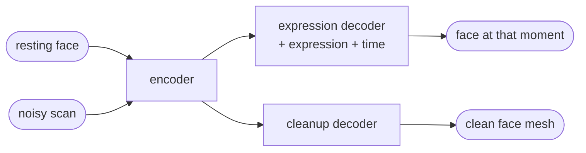

<div align="center">


# FaceMesh

**A PyTorch model that animates 3D faces and cleans up noisy face scans.**

[](requirements.txt)
[](facemesh/model.py)
[](Dockerfile)
[](LICENSE)

<br>


</div>

## ✨ What it does

FaceMesh is one neural network that does two jobs:

1. **Animate a face.** Give it someone's resting face, an expression (like a smile) and a point in time. It returns the face at that moment. Ask for 60 points in time and you get an animation.
2. **Clean up a 3D scan.** Give it a messy scan of a face: a cloud of points with noise, gaps and stray points. It returns a clean face mesh with the same layout as every other face, so it can be animated.

The output is saved as USD files, which open in Blender.

I trained it on [CoMA](https://coma.is.tue.mpg.de), a dataset of 20,465 3D face meshes: 12 people, each making 12 expressions.

## 🔬 How it works



- **Encoder.** Turns a set of 3D points into 256 numbers that describe the face. It's a PointNet: the same small network runs on every point, then it keeps the maximum of each number across all points. Taking the maximum means the order of the points doesn't matter, which is what you need for scans.
- **Expression decoder.** Takes those numbers plus the expression and the time, and predicts how far each point of the face moves from its resting position.
- **Cleanup decoder.** Takes the scan's numbers and predicts how far each point is from the average face.
- **Training scans are simulated.** I take a clean face mesh, cut a hole in it, add noise and some stray points, and shuffle the points. The clean mesh is the answer.
- **Loss.** It compares each predicted point with the real one, plus the lengths of the mesh edges so the surface stays smooth.

## 📊 Results

Error is the average distance between the predicted and real face points, in millimeters. Lower is better.

I tested it two ways:

- **New people:** 2 of the 12 people are left out of training completely.
- **Seen people:** every 10th frame is left out, but everyone appears in training.

To check that the model actually learned something, I compare it with a simple baseline: the average movement for each expression at each point in time. For scan cleanup, the comparison is just outputting the average face.

| | Expression: baseline | Expression: model | Scan cleanup: average face | Scan cleanup: model |
|---|---|---|---|---|
| New people | 1.58 | 1.58 | 5.28 | **2.59** |
| Seen people | 1.41 | **0.45** | 4.32 | **0.83** |

- For people it trained on, the model is about 3x better than the baseline at expressions and 5x better at scan cleanup.
- For new people, scan cleanup is still 2x better.
- The hard part is guessing how a *new* person's face will move from only their resting face. With just 10 people to learn from, the model can't do better than the average. Trained normally, it was worse (1.90 mm). So for new people I use `--baseline_correction`, which starts from the average and only learns small adjustments on top.

<p align="center">
  
</p>

## ⚡️ Run it

**Setup**

```bash
git clone https://github.com/simar-s2/facemesh && cd facemesh
python3 -m venv .venv
.venv/bin/pip install torch -r requirements.txt
```

**1. Get the data.** Request access to [CoMA](https://coma.is.tue.mpg.de) and unzip it. Then turn the 20,000 files into one:

```bash
.venv/bin/python scripts/preprocess_coma.py --coma_root path/to/COMA_data --out data/coma.npz
```

**2. Train.** For new people:

```bash
.venv/bin/python -m facemesh.train --data data/coma.npz --out_dir runs/coma_subject --epochs 30 --baseline_correction
```

For seen people, use `--split interpolation` instead of `--baseline_correction`. Training prints the baseline, then the error after every epoch, and saves the best model to `best.pt`.

**3. Use it.** Make one animation per expression for a person:

```bash
.venv/bin/python -m facemesh.export_usd expressions --checkpoint runs/coma_subject/best.pt \
    --data data/coma.npz --subject FaceTalk_170915_00223_TA --out_dir exports/new_person
```

Clean up a scan (a `.ply` or `.obj` file, in meters, facing forward):

```bash
.venv/bin/python -m facemesh.export_usd fit --checkpoint runs/coma_subject/best.pt \
    --scan my_scan.ply --out_dir exports/my_scan
```

To watch an animation, open Blender, go to File → Import → Universal Scene Description, pick a `.usda` file and press play.

## ☁️ Training on a GPU

The repo has a Docker image and a script for training on an AWS GPU:

1. Upload the data to S3: `aws s3 cp data/coma.npz s3://YOUR_BUCKET/data/coma.npz`
2. Start a **g5.xlarge** instance with the Deep Learning Base GPU AMI (Ubuntu) and an IAM role that can use the bucket.
3. SSH in, clone the repo, and run `BUCKET=YOUR_BUCKET ./scripts/train_on_aws.sh`. It builds the Docker image, trains both tests and copies the results back to S3.
4. Shut the instance down when it's done. It costs about $1 an hour.

## 💡 Things I learned

- **Always compare against a simple baseline.** My first results looked fine until I compared them with the average movement and saw the model was losing on new people.
- **Load meshes with `trimesh.load(path, process=False)`.** By default trimesh reorders the points, which silently breaks everything without any error.
- **Don't use BatchNorm in a shared encoder.** Mine sees both clean faces and noisy scans, so BatchNorm's averages ended up fitting neither.
- **A small dataset needs augmentation.** Randomly stretching each head by up to 5% during training helped the model handle people it hadn't seen.

## 🛠️ Development

```bash
.venv/bin/python -m pytest tests    # 5 quick checks
```

The tests check that point order doesn't change the encoder's output, that an untrained model returns the resting face, that simulated scans have the right size, and that USD files save every frame.

To redo the images in this README: `pip install matplotlib pillow`, then run `scripts/render_readme_media.py`.

## 📚 Citation

Results using CoMA should cite the paper:

```bibtex
@inproceedings{COMA:ECCV18,
  title     = {Generating 3D faces using Convolutional Mesh Autoencoders},
  author    = {Ranjan, Anurag and Bolkart, Timo and Sanyal, Soubhik and Black, Michael J.},
  booktitle = {European Conference on Computer Vision (ECCV)},
  pages     = {725--741},
  year      = {2018}
}
```

## 📄 License

[MIT](LICENSE) for the code. CoMA has its own license (non-commercial research only) and is not included in this repo.
